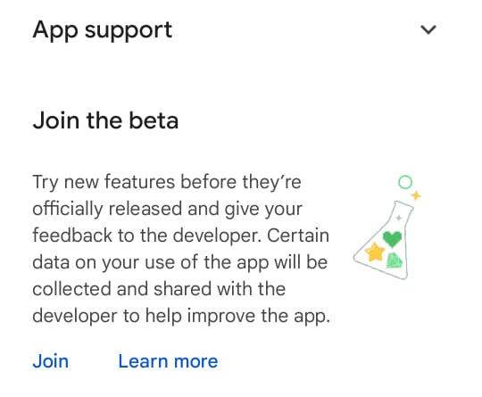
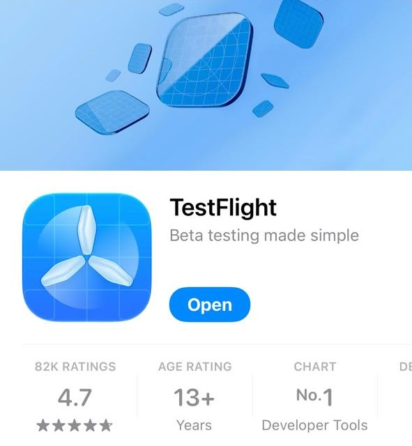
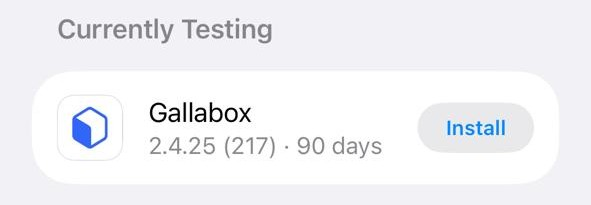

<Info>

The Gallabox beta program gives you early access to new features in the Gallabox mobile app before they reach everyone. Beta builds are available on Android through the Google Play Store and on iOS through Apple's TestFlight public beta. Your feedback helps us improve the app before each release.

</Info>

## About the beta program

Beta builds may include features that are still being finished, so you may notice occasional bugs or changes between updates. You use the same Gallabox account in the beta app as in the regular app.

## Join the beta on Android

<Steps>

<Step title="Open Gallabox in the Play Store">
Open the [Gallabox app page](https://play.google.com/store/apps/details?id=com.mangoleap.gallabox) in the Google Play Store on your Android device.
</Step>

<Step title="Find the beta section">
Scroll down to the **Join the beta** section, right below **App support**.

<Frame>
  
</Frame>
</Step>

<Step title="Join the beta">
Tap **Join** and confirm. It can take a few minutes for your account to be added to the beta.
</Step>

<Step title="Install or update the app">
Install Gallabox, or update it if it is already installed. The Play Store now gives you the beta version.
</Step>

</Steps>

## Join the beta on iOS

<Note>
Apple allows beta versions of iOS apps to be installed only through TestFlight, Apple's app for testing apps before release. You need TestFlight to install and use the Gallabox beta app.
</Note>

<Steps>

<Step title="Install TestFlight">
Install the [TestFlight](https://apps.apple.com/app/testflight/id899247664) app from the App Store on your iPhone.

<Frame>
  
</Frame>
</Step>

<Step title="Open the Gallabox beta link">
On your iPhone, open the Gallabox public beta link: [https://testflight.apple.com/join/PdBKCIAj](https://testflight.apple.com/join/PdBKCIAj)
</Step>

<Step title="Accept and install">
Tap **Accept**, then tap **Install** in TestFlight to download the Gallabox beta app.

<Frame>
  
</Frame>
</Step>

<Step title="Start using the beta app">
Once the install finishes, you can start using the beta app. Tap **Open** in TestFlight, or open Gallabox from your Home Screen, and log in with your Gallabox account.
</Step>

</Steps>

## FAQs

<AccordionGroup>

<Accordion title="Can I use the regular Gallabox app and the beta app at the same time?">
No. The beta app replaces the regular Gallabox app on your device, so you can't have both installed at once. You log in with the same Gallabox account, so you see the same conversations and data in the beta app.
</Accordion>

<Accordion title="Which updates do I get while I'm in the beta?">
On Android, you get only beta updates through the Play Store, not the regular production updates. On iOS, new beta builds appear in the TestFlight app.
</Accordion>

<Accordion title="How do I switch back to the regular app on Android?">
Once you've tried the new features, you can switch back to the regular app. Open the Gallabox page in the Play Store and tap **Leave** in the beta program section. You then get regular production updates again.
</Accordion>

<Accordion title="How do I switch back to the regular app on iOS?">
Install [Gallabox from the App Store](https://apps.apple.com/in/app/gallabox/id1542957177).
</Accordion>

</AccordionGroup>
